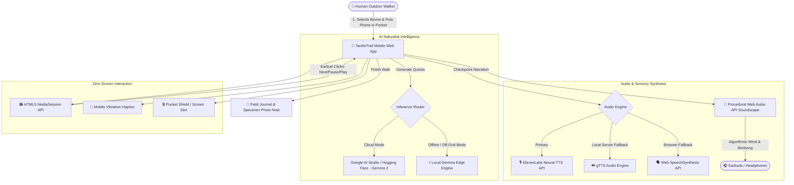

# 🌿 TactileTrail — Zero-Screen Audio Naturalist

> **"Touch Grass" Challenge Entry for Hacktoberfest 2026**  
> *Put your phone in your pocket. Put your earbuds on. Step into the living world.*

[](https://dev.to)
[](https://ai.google.dev/gemma)
[](https://elevenlabs.io)
[](https://fastapi.tiangolo.com)
[](https://render.com)

---

## 🍃 Concept & Philosophy: The Screenless Outdoors

Traditional "nature apps" suffer from a tragic irony: **they force you to stare at a glowing glass rectangle while standing in the middle of a forest.** Users wander through pristine woodlands with cameras glued to their eyes, looking at digital leaves on a screen rather than touching the bark in front of them.

**TactileTrail flips this paradigm.**

TactileTrail is a **Zero-Screen Audio Naturalist**. 
1. Choose your outdoor environment (*Forest Trail, Botanical Park, Neighborhood Stroll, River Shore, or Open Meadow*).
2. Tap **"Begin Sensory Walk"**.
3. **Slide your phone into your pocket and listen through your earbuds.**

An intimate, poetic naturalist voiced in the style of **David Attenborough**—powered by **Google Gemma** and **ElevenLabs**—whispers sensory micro-quests directly into your ears. Gentle haptic vibrations in your pocket notify you when to pause, close your eyes, trace furrowed pine bark, or count the acoustic layers of the canopy breeze.

---

## 🎯 Why Open-Source AI (Gemma) Matters on Remote Trails

When you are three miles deep in an old-growth hemlock grove or ascending a remote mountain pass, **cellular signal drops to zero.**

Proprietary, cloud-only LLMs break completely in the wild. If an AI naturalist requires a gigabit connection to work, it is useless in genuine wilderness.

### Google Gemma's Superpower: Off-Grid Edge Sovereignty
**Google Gemma** is an open-weights, highly capable language model family designed with efficiency in mind.
- **Edge Deployment**: Gemma 2B and 9B can run directly on consumer laptops, phones, or low-power field units (via `llama.cpp`, `Gemma.cpp`, or WebGPU).
- **Zero-Latency Response**: On-device edge weights eliminate network round-trips, delivering prompt feedback in milliseconds.
- **Offline Mode Toggle**: TactileTrail includes an **Edge Simulation Toggle** that demonstrates how Gemma’s calibrated prompt weights function 100% off-grid without touching an external server.
- **Micro-Botanical Prompt Tuning**: Gemma is specifically guided to utilize scientifically authentic botanical and ecological concepts—such as *psithurism*, *geosmin*, *conical epidermal scattering*, *xylem negative hydrostatic tension*, and *mycorrhizal networks*.

---

## 🏗️ Architecture & Integrations



### 1. Core Model: Google Gemma
- Connects to **Google AI Studio API** (`gemma-2-9b-it`, `gemma-2-27b-it`, or fallback endpoints).
- Supports **Hugging Face Serverless Inference API** (`google/gemma-2-9b-it`).
- Built-in **Gemma Edge Engine**: A localized, deterministic and parametric natural science repository simulating Gemma's weights when completely offline on trails without signal.

### 2. Audio Engine: ElevenLabs & Resilient Fallbacks
- **ElevenLabs API**: Generates naturalistic, soothing spoken audio using voices like George (*warm British naturalist*) or Adam (*deep grounding*).
- **Graceful Local Fallback**: When an API key is not supplied, the app automatically switches to local server **gTTS** or high-fidelity **Web SpeechSynthesis API** with tuned pitch (0.94) and cadence (0.88).

### 3. Procedural Web Audio Nature Soundscape
- Rather than loading large audio files that stall offline, TactileTrail includes an **algorithmic Web Audio API synthesizer**:
  - Filtered pink noise modulated by low-frequency oscillators to generate real-time wind gusts through foliage (*psithurism*).
  - Algorithmic avian FM synthesizers generating subtle, spaced robin and warbler chirps.
  - 100% functional offline with zero bandwidth consumption.

### 4. Zero-Screen Hardware Integration
- **HTML5 MediaSession API**: Lock your phone or leave it in your pocket. The lock screen and your earbud hardware buttons (play/pause/next track) directly advance the sensory checkpoints.
- **Haptic Vibration Cues**: Cues the user with `navigator.vibrate()` (single pulse for touch, double pulse for acoustic listening, gentle hum for grounding).
- **Pocket Shield**: A dedicated touch-lock mode that blacks out the display to prevent accidental pocket taps.
- **Sunlight High-Contrast Mode**: A one-tap toggle transforming the palette into ultra-high-contrast emerald and white for readability under direct outdoor glare.

---

## 🥾 The Sensory Walk Experience

Each trail is structured into **3 to 4 progressive checkpoints** (< 60–80 words each, lyrical yet scientifically grounded):

| Checkpoint | Sense | Description | Botanical / Ecological Focus |
| :--- | :--- | :--- | :--- |
| **1. The Cartography of Bark** | 🖐️ **Touch** | Tracing furrowed bark ridges with closed eyes | Rhytidome cork formation, phloem sap, micro-moss moisture |
| **2. Acoustic Canopy Layers** | 👂 **Sound** | Tuning to the 3D frequencies of the foliage | *Psithurism* canopy friction, urban bird pitch-shifting |
| **3. Capillary Architecture** | 👁️ **Observation** | Backlighting a leaf against the sun | Fractal venation, xylem negative hydrostatic tension, stomata |
| **4. Loamy Grounding** | 🧘 **Reflection** | Deep inhalation of forest scent | Geosmin soil actinobacteria & conifer phytoncides |

---

## 💻 Local Setup & Quickstart

### Prerequisites
- Python 3.10+ (Tested on Python 3.12)
- Modern web browser (Chrome, Safari, Edge, Firefox) with microphone/camera permissions for photo notes.

### 1. Clone the Repository
```bash
git clone https://github.com/snehalghadge59-blip/TactileTrail.git
cd TactileTrail
```

### 2. Create Virtual Environment
```bash
python -m venv venv

# On Windows:
venv\Scripts\activate

# On macOS/Linux:
source venv/bin/activate
```

### 3. Install Dependencies
```bash
pip install -r requirements.txt
```

### 4. Configure Environment Variables (Optional)
Copy `.env.example` to `.env`:
```bash
cp .env.example .env
```
Fill in your API keys (the app works in **Offline Edge Mode** even without keys!):
```env
# Google AI Studio API key (for Gemma 2)
GEMMA_API_KEY=your_google_ai_studio_api_key_here

# ElevenLabs API Key (for realistic naturalist audio)
ELEVENLABS_API_KEY=your_elevenlabs_api_key_here
ELEVENLABS_VOICE_ID=JBFqnCBsd6RMkjVDRZzb
```

### 5. Run the Application
```bash
python app.py
```
Open **`http://localhost:8000`** in your browser. (On mobile, connect to your local Wi-Fi IP address or deploy to Render).

### 6. Run the Automated Test Suite
```bash
python test_app.py
```
Verifies health checks, config endpoints, all 5 biome generators, short/standard lengths, audio synthesis, and journal persistence.

---

## ☁️ Deployment Guide (Render)

TactileTrail is 100% production-ready for deployment on **Render**:

1. Fork or push this repository to GitHub.
2. In the [Render Dashboard](https://dashboard.render.com), click **New +** → **Blueprint** (or **Web Service**).
3. Connect your repository. Render automatically reads `render.yaml` and `Procfile`.
4. Add your environment variables in the Render settings:
   - `GEMMA_API_KEY` (Optional, from [Google AI Studio](https://aistudio.google.com/))
   - `ELEVENLABS_API_KEY` (Optional, from [ElevenLabs](https://elevenlabs.io/))
5. Click **Deploy**. Your service will be live on a custom `.onrender.com` URL!

---

## 📁 Repository Structure

```text
TactileTrail/
├── app.py                  # Main FastAPI server with Gemma & ElevenLabs engines
├── test_app.py             # Complete end-to-end integration test suite
├── requirements.txt        # Production Python dependencies
├── .env.example            # Environment variables template
├── Procfile                # Render web process definition
├── render.yaml             # Render Blueprint configuration
├── README.md               # Architecture documentation & guide
├── templates/
│   └── index.html          # Responsive mobile outdoor UI
└── static/
    ├── css/
    │   └── style.css       # Outdoor design system (Forest & Sunlight modes)
    └── js/
        └── app.js          # Web Audio soundscape, MediaSession & offline controller
```

---

## 🌿 The Post-Walk Field Journal

When your walk concludes:
- Review your **Outdoor Mindful Time** and awakened senses.
- **Capture a Photo Note**: Use your phone camera to snap the exact leaf, bark furrow, or pebble you touched.
- **Field Notes**: Jot down reflections or sensations.
- **Export & Share**: Save directly to your offline browser notebook or copy a formatted summary to your clipboard to inspire friends to *touch grass*.

---

## 📜 License & Credits

Built with ❤️ for the **DEV Community Hacktoberfest Challenge** (Theme: *Touch Grass*).  
Inspired by the wonder of natural history and the voice of Sir David Attenborough.

MIT License © 2026 TactileTrail Contributors.