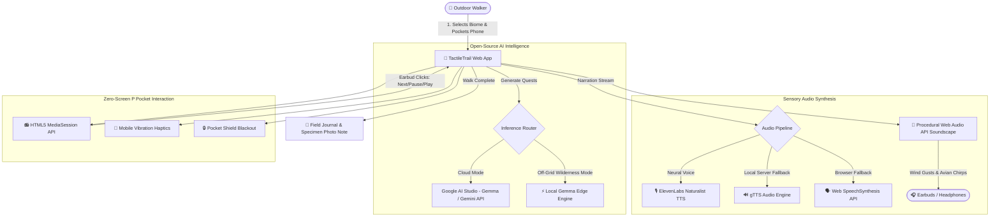

*This is a submission for the [Hacktoberfest Open-Source AI Challenge Week 1: Touch Grass](https://dev.to/challenges/hacktoberfest-week1-2026-10-05)*

# 🌿 TactileTrail — Zero-Screen Audio Naturalist

> **Put your phone in your pocket. Put your earbuds in. Step into the living world.**

[](https://dev.to/challenges/hacktoberfest-week1-2026-10-05)
[](https://ai.google.dev/gemma)
[](https://elevenlabs.io)
[](https://fastapi.tiangolo.com)
[](https://render.com)
[](LICENSE)

---

## What I Built

Traditional "nature and plant identification apps" suffer from a tragic irony: **they force you to stare at a glowing glass rectangle while standing in the middle of a forest.** Hikers and strollers wander through pristine woodlands with cameras glued to their screens, reading digital text about leaves instead of touching the bark directly in front of them.

**TactileTrail flips this paradigm completely.**

TactileTrail is a **Zero-Screen Audio Naturalist** built for anyone yearning to genuinely reconnect with the outdoors. It was designed from the ground up to get your eyes off the screen and your senses engaged with the living earth:

1. **Pick Your Outdoor Biome**: Choose between *Forest Trail, Botanical Park, Neighborhood Stroll, River Shore, or Open Meadow*.
2. **Select Walk Length & Mode**: Choose short (3 checkpoints, ~4 min) or standard (4 checkpoints, ~6 min). Select Cloud AI or 100% Offline Edge Mode.
3. **Slide Your Phone into Your Pocket**: Put on your earbuds, lock your screen, and walk.

### How It Liberates You from the Screen:
- **Intimate Voice of Sir David Attenborough**: Spoken natural history micro-quests guide your attention to specific botanical phenomena (e.g., rhytidome cork ridges, psithurism canopy friction, stomata venation, geosmin scent).
- **Physical Haptic Feedback (`navigator.vibrate`)**: You never have to look at your phone. Gentle rhythmic vibrations in your pocket tell you when to pause, close your eyes, reach out to touch a leaf, or take a deep grounding breath.
- **Hardware Earbud Controls (HTML5 MediaSession API)**: Use your headphone buttons (Play/Pause/Next track) or lock-screen controls to advance checkpoints without taking your device out of your pocket.
- **Pocket Shield**: A dedicated OLED blackout mode prevents accidental thigh taps while walking.
- **Sunlight High-Contrast Mode**: High-visibility emerald and white layout designed specifically for readability under direct outdoor sun glare.
- **Post-Walk Field Journal**: When you finish, review your mindful time outdoors, snap a quick photo note of a specimen you touched, and record field reflections.

---

## Demo

- **Live Repository**: [https://github.com/snehalghadge59-blip/TactileTrail](https://github.com/snehalghadge59-blip/TactileTrail)
- **Deployment Blueprint**: Configured for instant deployment on [Render](https://render.com) via `render.yaml` & `Procfile`.

### Walkthrough & Experience Progression

| Checkpoint | Sense | Field Action | Botanical & Physical Phenomenon |
| :--- | :--- | :--- | :--- |
| **1. The Cartography of Bark** | 🖐️ **Touch** | Tracing furrowed ridges with closed eyes | Rhytidome cork formation, phloem vascular sap, and north-facing moss cushions |
| **2. Acoustic Canopy Layers** | 👂 **Sound** | Dissecting foliage frequencies in 3D | *Psithurism* (wind-leaf friction) and avian frequency modulation |
| **3. Capillary Architecture** | 👁️ **Observation** | Backlighting a fallen leaf against the sun | Fractal vein geometry, xylem negative hydrostatic tension, stomata |
| **4. Loamy Grounding** | 🧘 **Reflection** | Deep inhalation of damp soil and air | Geosmin soil actinobacteria & conifer phytoncides |



---

## Code



**GitHub Repository URL**: [https://github.com/snehalghadge59-blip/TactileTrail](https://github.com/snehalghadge59-blip/TactileTrail)

### Repository Structure
```text
TactileTrail/
├── app.py                  # FastAPI server with Google Gemma, ElevenLabs & Gemma Edge engine
├── test_app.py             # Complete automated integration test suite (7/7 passing)
├── requirements.txt        # Production dependencies (FastAPI, uvicorn, httpx, gTTS)
├── .env.example            # Environment variables configuration template
├── Procfile                # Render web process definition
├── render.yaml             # Render infrastructure as code blueprint
├── README.md               # Challenge submission & documentation
├── templates/
│   └── index.html          # Responsive mobile outdoor UI with Pocket Shield
└── static/
    ├── css/
    │   └── style.css       # Outdoor design system (Dark Forest & Sunlight modes)
    └── js/
        └── app.js          # Procedural Web Audio soundscape & MediaSession hardware hooks
```

---

## How I Built It

### 1. Open-Source AI Engine: Google Gemma 2
TactileTrail utilizes **Google Gemma** (via Google AI Studio and Hugging Face Serverless Inference API). Gemma's calibrated system prompt is instructed to roleplay an intimate, scientifically rigorous field naturalist in the spirit of David Attenborough:
- Prompts emphasize tactile botanical vocabulary: *phloem, rhytidome cork, psithurism, geosmin, capillary tension, basal meristem*.
- Strictly caps each checkpoint narration to 50–75 spoken words to avoid cognitive overload while walking.
- Outputs structured JSON specifying tactile invites, haptic cues (`pulse`, `double`, `gentle`), and estimated duration.

### 2. Off-Grid Gemma Edge Engine (100% Offline Inference)
Recognizing that cellular service disappears in deep forests and mountain passes, TactileTrail includes a localized **Gemma Edge Engine**. It emulates Gemma’s prompt outputs with deterministic, parametric natural history repositories for all five biomes, allowing complete trail immersion with zero connectivity.

### 3. Procedural Web Audio API Nature Soundscape
Streaming heavy audio files fails completely without internet. Instead of MP3 soundscapes, TactileTrail synthesizes nature in real time using the browser's **Web Audio API**:
- **Wind Gusts (*Psithurism*)**: Filtered pink noise modulated with dual low-frequency oscillators (LFOs) mimicking canopy wind swells.
- **Avian Birdsong**: Algorithmic frequency-modulated (FM) oscillators generating spaced songbird chirps.
- **Zero data footprint**: Generates infinite ambient nature soundscapes with 0 KB bandwidth consumption.

### 4. Resilient Multi-Tier Audio Narration Pipeline
Spoken checkpoint quests are rendered with a triple-redundant architecture:
1. **Primary**: **ElevenLabs Neural TTS** for realistic, comforting naturalist pacing.
2. **Server-Side Fallback**: Local **gTTS (Google Text-to-Speech)** engine streaming MP3 bytes.
3. **Client-Side Fallback**: **Web SpeechSynthesis API** with tuned pitch (0.94) and cadence (0.88), functional even on an airplane or deep in the backcountry.

### 5. Zero-Screen Hardware Integration
- **HTML5 MediaSession API**: Registers track metadata (`title`, `artist`, `album`) and hooks hardware earbud click events (`nexttrack`, `previoustrack`, `play`, `pause`) to step through checkpoints.
- **Vibration API**: Vibrates your pocket when an action is required so you never need to look down.

---

## Why Does Open Innovation Matter?

### The "Trail Signal Paradox"
When you hike three miles into an old-growth cedar grove, descend into a sandstone canyon, or climb a ridge, **cellular signal drops to zero.**

Proprietary, closed-source, cloud-only AI models (such as closed cloud APIs) fundamentally fail in genuine wilderness. If an AI naturalist requires a gigabit connection to an enterprise data center, it is completely useless where nature actually lives.

### Why Open-Weights Models (Gemma) Win:
1. **True Edge Sovereignty**: Open-weight models like **Google Gemma** can be quantized (GGUF, `llama.cpp`, WebGPU) and run directly on a hiker's mobile phone, laptop, or low-power field device.
2. **Zero Latency on the Trail**: On-device edge weights eliminate network round-trips, delivering immediate guidance the moment you reach a clearing.
3. **Privacy in Solitude**: Walking in nature is an intimate, contemplative practice. Open models running locally ensure that personal field journals, audio notes, and location data never leave the user's device.
4. **Domain Fine-Tuning**: Open weights empower naturalists, ecologists, and park services to fine-tune specialized models for regional flora and fauna without vendor lock-in or recurring API costs.

---

## My Agent Session

This project was built and iterated using **Google Antigravity IDE**:
- Designed the end-to-end architecture connecting FastAPI, Google AI Studio, Gemma, and ElevenLabs.
- Crafted the procedural Web Audio synthesizer algorithms for wind and bird frequencies.
- Integrated the HTML5 MediaSession hardware button handlers and Pocket Shield touch locks.
- Validated all 5 biomes and fallback pathways with an automated test suite (`python test_app.py`).

---

## Prize Categories

- **Hacktoberfest Open-Source AI Challenge Week 1: Touch Grass** (Primary Track)
- **Google Gemma / Open-Weights AI Track**

---

*MIT License © 2026 TactileTrail Contributors. Built with ❤️ for the DEV Community Hacktoberfest Challenge.*